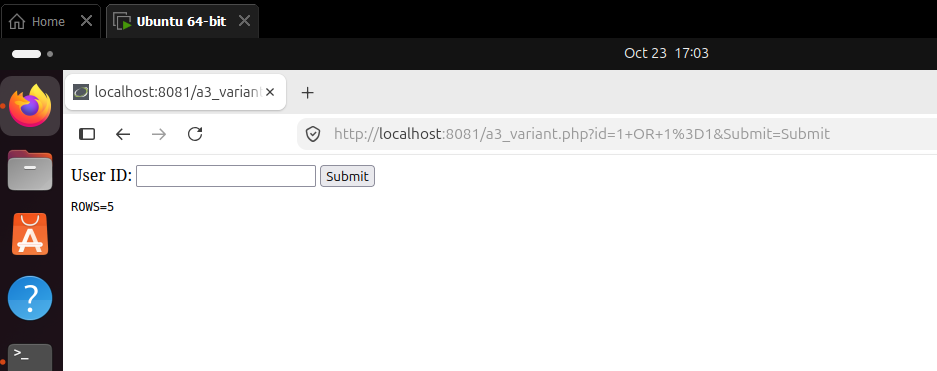
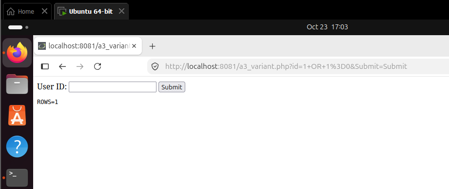

# Ground Truth: Boolean-Blind Injection on the Variant Page (OR)

This establishes the expected behavior of `a3_variant.php` **independently
of SQLiFuzz**.

## Method

Manual HTTP requests sent directly to DVWA (port 8081), bypassing the
SQLiFuzz proxy (port 8888) entirely, no SQLiFuzz process was running
during this check.

## Context and expected behavior

Date: October 23, 2026, approximately 17:03 according to the VM display.

Target: authenticated local DVWA page `a3_variant.php`. The tested parameter is `id`, submitted using GET. Source: `cases/a3_variant.php`.

The page constructs the following query by directly inserting the supplied value:

```sql
SELECT first_name, last_name FROM users WHERE user_id = $id
```

The expected behavior follows from this query:

- `1 OR 1=1` makes the WHERE condition true for every row, so it should return all users.
- `1 OR 1=0` leaves the condition equivalent to `user_id = 1`, so it should return only user ID 1.

The exact number returned by the first request depends on the database contents.

## Test 1
```
Request: id = 1 OR 1=1
URL: http://localhost:8081/a3_variant.php?id=1+OR+1%3D1&Submit=Submit
```
**Result:** `ROWS=5`
**Screenshot:** 




## Test 2
```
Request: id = 1 OR 1=0
URL: http://localhost:8081/a3_variant.php?id=1+OR+1%3D0&Submit=Submit
```
**Result:** `ROWS=1`
**Screenshot:** 




## Interpretation
The manual requests returned `ROWS=5` for `1 OR 1=1` and `ROWS=1` for `1 OR 1=0`. These observations agree with the expected SQL behavior: the true OR condition broadens the selection to all five users, while the false OR condition preserves the user-ID comparison.

Together with source inspection, this establishes that the supplied input can change SQL query logic. Both requests return rows, making this a useful variant beyond the primary AND pair's rows-versus-no-rows behavior.

These checks establish the vulnerability independently of SQLiFuzz's verdict. They do not demonstrate that the prototype detects it; that conclusion is supported separately by the recorded variant trials.

The screenshots show the inputs, target port, and outputs. The statement that SQLiFuzz was stopped is part of the recorded manual procedure, rather than something established by the screenshots themselves.
